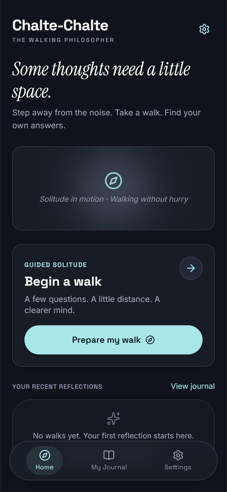
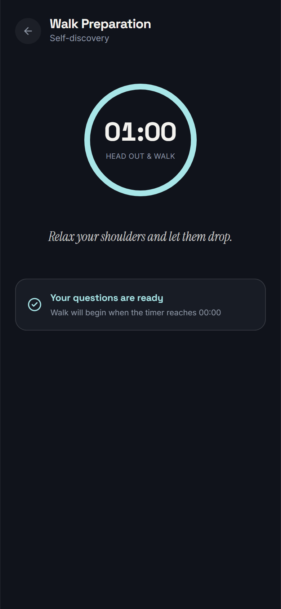
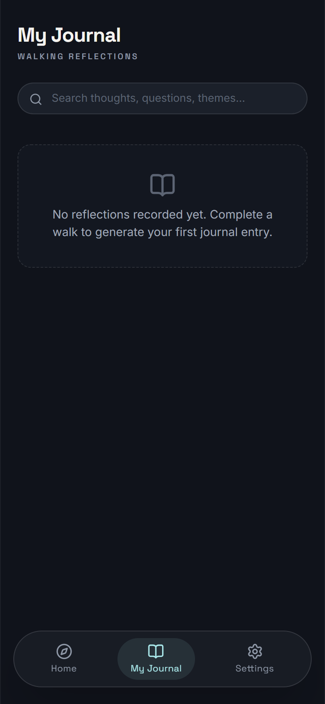
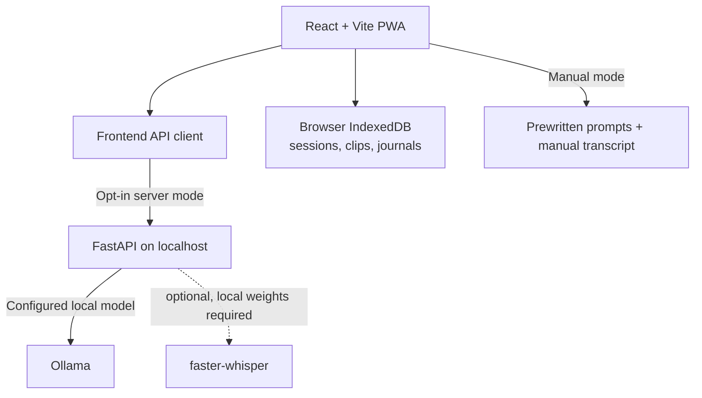

# Chalte-Chalte — The Walking Philosopher

*An AI companion for reflective walks. Ask better questions, think out loud, and turn your walks into a personal journal.*

Chalte-Chalte gives a walk a little structure: choose an intention, reflect at your own pace, and keep the thoughts you want to revisit. The app is designed to work without an account or cloud journal. Optional AI features can use a FastAPI service connected to a locally running Ollama model.

> **Current state:** The React/Vite PWA and local API integration are in the repository. AI server mode is opt-in. Transcription depends on a separately configured local Whisper model; see [backend setup](README_BACKEND.md).

<details>
<summary><strong>Table of contents</strong></summary>

- [Overview](#overview)
- [Features](#features)
- [Screenshots](#screenshots)
- [Architecture](#architecture)
- [Tech stack](#tech-stack)
- [Prerequisites](#prerequisites)
- [Quick start](#quick-start)
- [Frontend setup](#frontend-setup)
- [Backend setup](#backend-setup)
- [Local AI setup](#local-ai-setup)
- [Environment configuration](#environment-configuration)
- [Testing](#testing)
- [Project structure](#project-structure)
- [Privacy and security](#privacy-and-security)
- [Known limitations](#known-limitations)
- [Roadmap](#roadmap)
- [Contributing](#contributing)
- [License](#license)
- [Acknowledgments](#acknowledgments)

</details>

## Overview

Many people do their clearest thinking away from a desk, but a walk can pass without leaving space to reflect. Chalte-Chalte pairs a walking session with a few open-ended prompts and a place to keep reflections afterward. It aims to support the user's own thinking rather than tell them what to think.

## Features

### Implemented in the app

- Set a topic, mood, language, and walk duration before a session.
- Follow a timed walking session with scheduled reflection prompts.
- Record voice notes in a browser that supports `MediaRecorder` and microphone access.
- Review and edit reflections, then keep journals in browser IndexedDB.
- Use prewritten question prompts and manual transcription in the on-device/manual mode.
- Enable the optional server mode from **Settings**; API errors are surfaced rather than silently replaced with mock AI output.

### Optional local AI integrations

- FastAPI `/v1/questions` and `/v1/journal` routes call the Ollama model configured in `backend/.env`.
- The journal API checks transcript quotes before retaining ideas and keeps reflection excerpts grounded in the submitted text.
- `/v1/transcribe` is available only when `faster-whisper` and local model files are explicitly configured. The backend does not download transcription weights at startup.
- `npm run dev:mock` enables simulated API responses for UI development. These responses are demo data, not model output.

## Screenshots

The repository includes these checked-in app captures:

| Home | Walk preparation | Journal |
| --- | --- | --- |
|  |  |  |

## Architecture



## Tech stack

| Area | Technology |
| --- | --- |
| Frontend | React, TypeScript, Vite |
| PWA and offline assets | `vite-plugin-pwa`, service worker |
| Local browser storage | IndexedDB through `idb` |
| API | Python, FastAPI, Pydantic, HTTPX |
| Local text generation | Ollama, model selected with `OLLAMA_MODEL` |
| Optional transcription | `faster-whisper` with explicitly provisioned local weights |
| Tests | Vitest; pytest for the backend |

## Prerequisites

- Node.js and npm (the repository includes `package-lock.json`).
- Python 3.11 or newer with a compatible FastAPI/Pydantic installation for the backend.
- Ollama and a model already available locally for real server-mode question or journal generation.
- Microphone permission for browser voice recording. Transcription additionally needs its optional local Whisper setup.

## Quick start

For the frontend-only/manual experience, run:

```powershell
npm ci
if (-not (Test-Path .env.local)) { Copy-Item .env.example .env.local }
npm run dev
```

Vite prints the local URL when ready. To use server AI, start Ollama and the backend as described in [Backend setup](#backend-setup), then opt in under **Settings → My server**. The client is configured for `http://127.0.0.1:8000` by default.

## Frontend setup

From the repository root:

```powershell
npm ci
if (-not (Test-Path .env.local)) { Copy-Item .env.example .env.local }
npm run dev
```

Use `npm run dev:mock` when working on screens that need simulated API responses. The normal `npm run dev` mode does not enable the mock service worker.

## Backend setup

Backend installation, environment settings, endpoint examples, and optional transcription instructions are maintained in [README_BACKEND.md](README_BACKEND.md).

Quick start from the repository root, using Python 3.13 on Windows:

```powershell
py -3.13 -m venv backend\.venv
.\backend\.venv\Scripts\Activate.ps1
python -m pip install -r backend\requirements.txt
if (-not (Test-Path backend\.env)) { Copy-Item backend\.env.example backend\.env }
Set-Location backend
python -m uvicorn main:app --host 127.0.0.1 --port 8000
```

Keep the backend bound to loopback for local development. Start Vite in a separate terminal.

## Local AI setup

The backend reads `backend/.env`; process environment variables take precedence. Choose a model that `ollama list` shows as installed and set its exact tag as `OLLAMA_MODEL`. The checked-in example uses `gemma3:1b` as a sample configuration, but model availability depends on the machine. No model is downloaded automatically.

Check readiness at `http://127.0.0.1:8000/v1/health`. Server-mode generation sends the configured intention or journal transcript to the configured FastAPI service. Keep `OLLAMA_BASE_URL` pointed at your local Ollama service when you want inference to stay on your machine.

## Environment configuration

| File | Purpose | Commit? |
| --- | --- | --- |
| `.env.example` | Vite API URL and demo-mode example | Yes |
| `.env.local` | Local Vite overrides | No |
| `backend/.env.example` | Backend Ollama, bind, and CORS examples | Yes |
| `backend/.env` | Local backend settings | No |

The ignore rules allow only `.env.example` among `.env*` files. Never put credentials, personal data, or machine-specific private values in an example file.

## Testing

From the repository root:

```powershell
npx vitest run
npm run build
python -m pytest backend\test_main.py -v
```

The backend tests mock Ollama; they do not prove that a chosen model is installed or that its generated output will always pass validation. For local endpoint checks, follow the commands in [README_BACKEND.md](README_BACKEND.md).

## Project structure

```text
.
├── backend/              # FastAPI app, tests, environment example, smoke script
├── public/               # PWA icons and service-worker assets
├── scripts/              # Existing UI verification and screenshot scripts
├── src/
│   ├── core/             # Session engine, IndexedDB, API clients, AI services
│   ├── screens/          # Existing React application screens
│   └── mocks/            # Mock Service Worker handlers
├── stitch-ref/           # Existing design references
├── API_CONTRACT.md       # Frontend/backend contract
├── README_BACKEND.md     # Detailed local backend setup
├── package.json
└── vite.config.ts
```

## Privacy and security

- The app's sessions, recordings, transcripts, and journals are stored in browser IndexedDB by the frontend; this is local browser storage, not encrypted cloud backup.
- In manual mode, AI-specific API calls are not made. In server mode, the frontend sends intention fields, audio for transcription, or transcript text to the configured backend endpoint as applicable.
- The backend is intended for loopback development, does not persist request content, and avoids logging prompt or transcript bodies. Configure CORS and the Ollama URL for the machine where the backend runs.
- A custom `OLLAMA_BASE_URL` can point somewhere other than the local machine. Review your configuration before sending private reflections.
- Do not commit `.env`, audio, transcripts, journals, local databases, or model weights.

## Known limitations

- There is no hosted demo, login, cloud sync, or cloud database in this repository.
- Server AI requires Ollama to be running and the configured model to be installed.
- Transcription is optional and unavailable until `faster-whisper` and local model files are configured.
- AI output quality and schema compliance depend on the selected local model; invalid output is reported as an error rather than shown as generated content.
- Browser recording and persistent storage behavior vary by browser and permission settings.

## Roadmap

Possible future work, not a claim of completed features:

- Improve model-specific output validation and local integration coverage.
- Add a simple export/import path for journals that remains user-controlled.
- Document and test transcription setup on supported Windows configurations.
- Improve accessibility and keyboard-only testing across the walk flow.

## Contributing

1. Fork the repository and create a focused branch: `git switch -c feature/your-change`.
2. Install the frontend dependencies with `npm ci`; install backend dependencies only when changing the API.
3. Run the relevant tests and build before opening a pull request.
4. Describe what changed, how you verified it, and any model or browser requirements.
5. Keep private data, environment files, model files, and generated local state out of commits.

## License

No license has been selected yet. Until one is added by the project owner, reuse and redistribution permissions are not specified.

## Acknowledgments

Built with the open-source React, Vite, FastAPI, Ollama, and related tools listed in the project manifests. Thanks to the open-source maintainers whose work makes local-first experiments possible.
